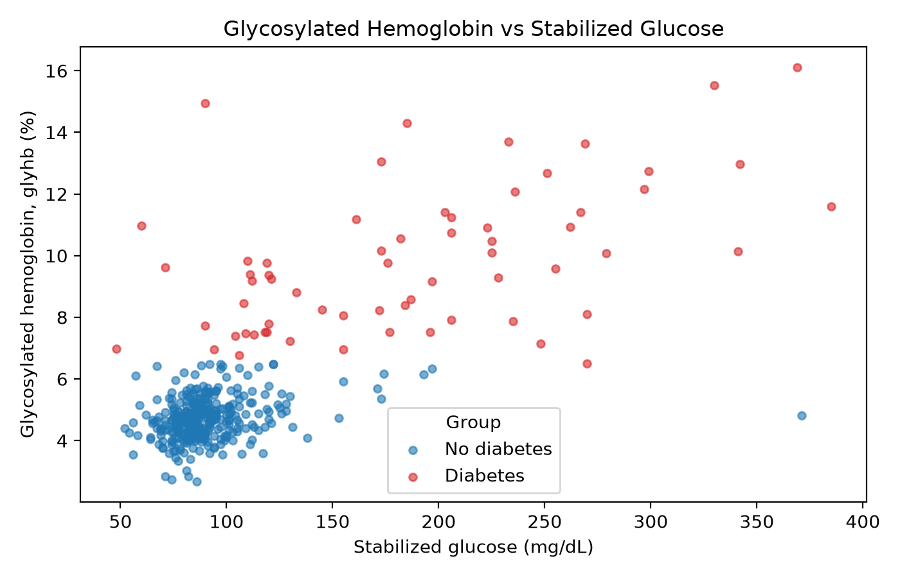

# STA 556 Homework 2: Diabetes Data Pipeline

## Purpose
A small, reproducible Python pipeline that reads an external dataset, cleans it with reusable
functions, and shows one clear finding visually.

## Data Source
Kaggle "Diabetes" dataset (`diabetes.csv`) by Mohamadreza Momeni,
https://www.kaggle.com/datasets/imtkaggleteam/diabetes, accessed October 17, 2026.
Raw data on rural African-American patients in central Virginia (403 rows, 19 columns).
License: "Other (specified in description)" on Kaggle.

Original study: Willems JP, Saunders JT, Hunt DE, Schorling JB. Prevalence of coronary heart
disease risk factors among rural blacks: a community-based study. Southern Medical Journal.
1997;90:814-820.

**Data:** `diabetes.csv` is included in `data/`. The original file can also be downloaded
from the Kaggle page above (free account required).

## Project Structure
```
sta556-homework-2/
├── data/
│   └── diabetes.csv          # raw dataset (403 rows, 19 columns), not modified
├── src/
│   ├── data_loader.py        # function that reads diabetes.csv into a pandas DataFrame
│   └── cleaning.py           # reusable cleaning functions: drops rows missing glyhb, age
│                             #   or weight, removes the mostly empty second blood pressure
│                             #   columns, and creates the diabetes indicator (glyhb >= 6.5)
├── notebooks/
│   └── analysis.ipynb        # main analysis: loads and cleans the data using src/,
│                             #   summarizes it, and produces the figures
├── figures/                  # plots saved by the notebook (e.g. fig3_glyhb_vs_glucose.png)
├── requirements.txt
└── README.md
```

The notebook depends on the other folders. It imports its functions from `src/`, reads the
data from `data/`, and writes its plots to `figures/`. Keep this folder structure as it is,
or the notebook will not find its files.

## How to Run
1. **Get the whole repository, not just the notebook.
   Downloading only `analysis.ipynb` will fail, because `src/` and `data/` will be missing.
2. **Open the top-level `sta556-homework-2` folder** in VS Code (**File → Open Folder**)
   or in Jupyter, not the `notebooks/` folder by itself.
3. **Check that `data/diabetes.csv` is present.**
4. **Open `notebooks/analysis.ipynb`**, select your Python kernel, and **run all cells
   from top to bottom** (**Run All**). The cells depend on earlier ones, so run them in
   order.
5. **Check the outputs.** The results tables appear in the notebook, and the plots are
   saved to `figures/`.

## Cleaning Notes
Diabetes is defined as glycosylated hemoglobin (`glyhb`) of 6.5% or higher, the standard
clinical threshold. Rows missing `glyhb`, `age` or `weight` were removed (14 of 403), and the
two mostly empty second blood pressure columns were dropped.

## Main Finding
Stabilized glucose is the strongest correlate of glycosylated hemoglobin (r = 0.74). Patients
with diabetes (64 of 389 patients) had a median glucose of about 183 mg/dL versus 86 mg/dL for
those without, and were older (median age about 59.5 versus 41). Diabetes prevalence was
similar across gender and county.

